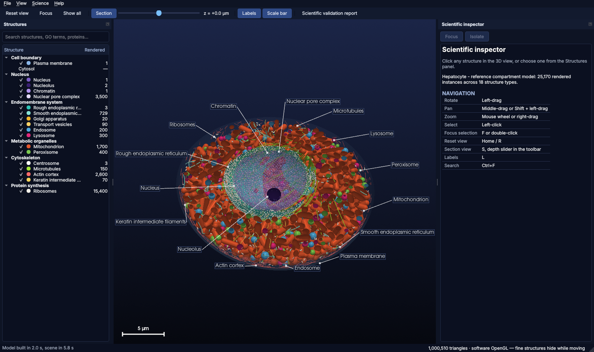
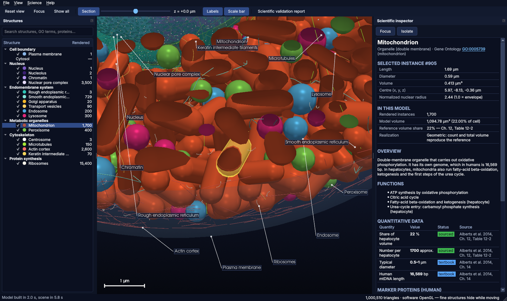
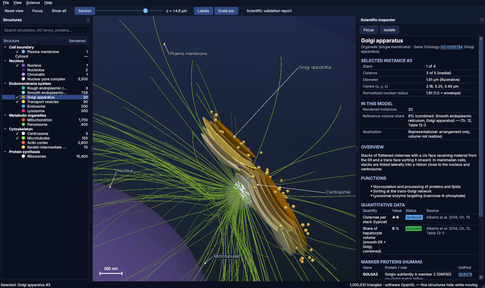
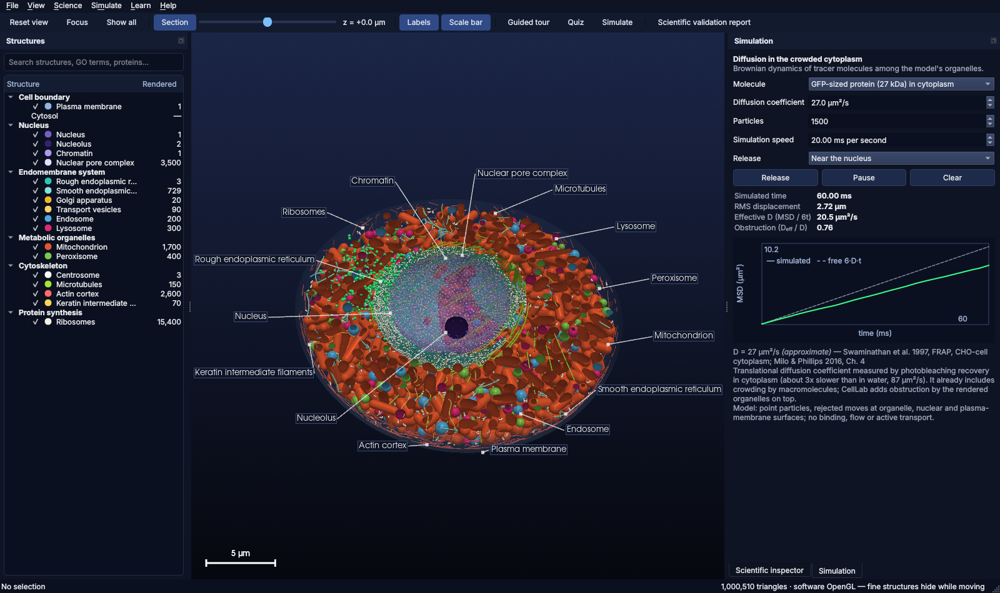

# CellLab — offline 3D cellular laboratory

CellLab is a desktop application (Windows and Linux) for exploring a quantitatively modeled
mammalian hepatocyte in 3D. Compartment counts and volumes reproduce a cited reference table.
Every quantity shows its source and a validation status, and everything runs offline.



## What works today (Phase 1, tested)

- **3D cell explorer** with 1,700 mitochondria, 400 peroxisomes, 300 lysosomes and 200 endosomes
  (counts and volume fractions exactly as in Alberts et al. 2014, Table 12-2). It also contains
  the nucleus with 3,500 nuclear pores, nucleoli and chromatin, rough-ER sheets with bound
  ribosomes, a smooth-ER network, a Golgi ribbon around the centrosome (two 9×3 centrioles),
  microtubules, an actin cortex, keratin filaments, transport vesicles and free polysomes.
  That is about 1.0 million triangles and 2,600 non-overlapping organelles in a deterministic
  layout.
- **Navigation and selection:** rotate, pan, zoom, click-to-select any single organelle,
  double-click or `F` to fly to it, and section view with a depth slider.
- **Scientific labelling:** occlusion-aware leader-line labels and a live scale bar.
- **Scientific inspector:** GO term, summary, functions, quantitative table with
  sourced/textbook/approximate/model/illustrative badges, human marker proteins with UniProt
  accessions, representation notes, full references, and per-instance measurements.
- **Structure browser** with visibility toggles, isolate/show-all and search (names, synonyms,
  GO IDs, genes, accessions).
- **Validation report** (model vs reference) and a `--self-test` for packaged builds.
- **Simulation (Phase 6, first engine):** Brownian diffusion of tracer molecules (GFP-sized protein,
  D = 27 µm²/s in cytoplasm) through the cell, blocked by organelles, the nucleus and the membrane.
  Live particles in 3D and a mean-squared-displacement plot against free 6·D·t diffusion.
- **Learning (Phase 7, first tools):** a narrated 14-stop guided tour and a quiz generated from the
  cited knowledge base, with immediate feedback, the source of every answer and "Show in 3D".
- **83 automated tests:** knowledge-base integrity, reference transcription, geometry maths,
  exact no-overlap packing, mesh volumes, validation, inspector, and end-to-end GUI including
  real mouse picking and a no-network guard.

| Selection with per-instance measurements | Golgi ribbon, centrosome and microtubule aster |
|---|---|
|  |  |



## Install on Windows (one click)

1. Extract the project zip (right-click → **Extract All**).
2. Double-click **`SETUP_CellLab.bat`**. If Windows shows "Windows protected your PC", choose **More info → Run anyway**.
3. Wait 5–15 minutes. The first run needs internet: it downloads Python and the libraries (~400 MB), then builds and self-tests `CellLab.exe`.
   It installs CellLab to `%LOCALAPPDATA%\Programs\CellLab`, adds a **CellLab** icon to the desktop and Start menu, and opens the app. After that it runs fully offline.

## Run from source

```bash
# Windows (PowerShell) or Linux; needs uv (https://docs.astral.sh/uv/)
uv sync
uv run cellab
```

## Test

```bash
uv run pytest            # Windows / Linux desktop
xvfb-run -a uv run pytest  # headless Linux
```

## Build the offline executable

| Target | Command | Output |
|---|---|---|
| Windows | `powershell -ExecutionPolicy Bypass -File packaging\build_windows.ps1` | `build\CellLab-<v>-win64-portable.zip`, plus `build\CellLab-<v>-win64-setup.exe` if Inno Setup 6 is installed |
| Linux | `./packaging/build_linux.sh` | `build/CellLab-<v>-linux-x86_64.tar.gz` |
| CI | `.github/workflows/build.yml` | Linux tests and bundle; Windows bundle and installer as artifacts |

Each build script runs the packaged app's `--self-test` and fails if it does not pass.

## Documentation

- [docs/USER_MANUAL.md](docs/USER_MANUAL.md) — how to use the app
- [ARCHITECTURE.md](ARCHITECTURE.md) — technical design and extension points
- [SCIENCE_VALIDATION.md](SCIENCE_VALIDATION.md) — sources, checks and limitations
- [PROJECT_STATE.md](PROJECT_STATE.md) / [TASKS.md](TASKS.md) — progress and next steps
- [THIRD_PARTY_NOTICES.md](THIRD_PARTY_NOTICES.md) — licences of bundled components

## Project layout

```
src/cellab/{science,model,render,ui}   application code (see ARCHITECTURE.md)
src/cellab/data/                       knowledge base, cell profiles, icon
tests/                                 pytest suite
packaging/                             PyInstaller spec, build scripts, Inno Setup installer
scripts/                               icon, screenshots, licence notices generators
```

The project's own licence has not been chosen yet (see TASKS.md).
